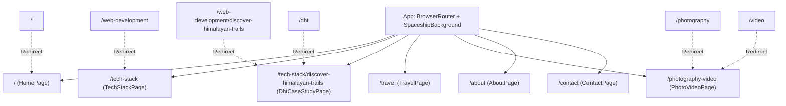

# Portfolio Architecture & Engineering Guide

> **Project**: Ashish Nirankari — Digital Portfolio & Showcase  
> **Repository**: `Ashish00968/a_portfolio` (`ashish-portfolio`)  
> **Tech Stack**: React 19, Vite 8, React Router v7 (`react-router-dom`), Framer Motion, Vanilla CSS Design Tokens, Lucide React  
> **Theme Direction**: Spaceship.com-inspired Cosmic Obsidian with Orbital Telemetry & Dynamic Cursor Spotlights

---

## 1. High-Level System Overview

This project is a high-performance, multi-route web application engineered with **React 19**, **React Router DOM**, and bundled with **Vite 8**. It showcases the multifaceted identity of Ashish Nirankari: Computer Science student at IIITDM Jabalpur, creator of the flagship 3D Himalayan travel atlas (*Discover Himalayan Trails*), geospatial systems builder, and high-altitude visual creator.

### Architectural Core Principles
1. **Multi-Route Navigation with Dual-Platform SPA Resilience**: Clean dedicated routes powered by `react-router-dom` with Netlify fallback routing (`public/_redirects`), GitHub Pages fallback routing (`dist/404.html`), dynamic `base` and `basename` resolution, and universal asset paths (`getAssetPath()`).
2. **Spaceship Aesthetic & Dynamic Motion**:
   - Cosmic Obsidian base palette (`#06090e`, `#0a0d10`, `#11161c`).
   - `SpaceshipBackground.jsx`: Lightweight, hardware-accelerated starfield and orbital nebula canvas respecting `prefers-reduced-motion`.
   - `SpotlightCard.jsx`: Interactive mouse-tracking radial spotlight (`--mouse-x`, `--mouse-y`) with subtle illuminated borders.
   - Orbital Telemetry HUD badges (`[ONLINE / ACTIVE]`, coordinates, altitude, base station).
3. **Zero Bloat, High Speed**: Pure Vanilla CSS design tokens instead of heavy CSS-in-JS runtimes. Lightning-fast Vite builds (~220ms), tiny bundle footprint, 0 ESLint errors.
4. **Single Source of Truth**: All copy, route descriptors, skills, case studies, galleries, and telemetry metadata reside in `src/data/portfolioData.js`.
5. **Emil Kowalski Animation Discipline (`emil-design-eng`)**: No `transition: all`, transform and opacity-driven spring physics, snappiest easings (`cubic-bezier(0.23, 1, 0.32, 1)`), tactile `:active` feedback (`scale(0.97)`).
6. **Portrait Slot Architecture**: `HeroPortrait.jsx` auto-detects `public/ashish-portrait.jpg` via client-side `Image()` preloading, gracefully falling back to mountain placeholder visuals until Ashish uploads his portrait photo.

---

## 2. Project Directory Map

```
ashish-portfolio/
├── .agents/                 # AI agent rules & design engineering skills
│   └── skills/              # emil-design-eng, frontend-design, ui-ux-designer
├── public/                  # Static assets served at root
│   ├── _redirects           # Netlify SPA routing fallback (/*  /index.html  200)
│   ├── after.jpg            # Graded mountain still for before/after comparison
│   ├── before.jpg           # RAW LOG mountain still for before/after comparison
│   ├── sethan-thumbnail.jpg # Sethan Hampta Valley still & fallback placeholder
│   ├── patalsu-thumbnail.jpg# Patalsu Peak summit ridge thumbnail
│   ├── manali-transitions-thumbnail.jpg # Manali transitions still
│   ├── kalpa-thumbnail.jpg  # Kinnaur Kalpa landscape still
│   ├── ashish-portrait.jpg  # Authentic portrait at Himalayan gateway arch (Hero)
│   ├── field-explorer-glacier.jpg # Ashish surveying Pir Panjal glaciers (Travel & Gallery)
│   ├── pir-panjal-glacier-face.jpg # Glacial face & rock chutes (DHT Case Study & Gallery)
│   └── alpine-reflection-ridge.jpg # Ashish atop 3,978m Rohtang pass ridge (About & Travel)
├── src/
│   ├── assets/              # SVG icons & internal assets
│   ├── components/
│   │   ├── home/            # Homepage-specific components
│   │   │   ├── HeroPortrait.jsx   # Portrait slot with auto-detection & fallback
│   │   │   └── HeroPortrait.css
│   │   ├── layout/          # Global layout chrome
│   │   │   ├── Navbar.jsx & .css  # Fixed frosted glass header, flagship pill, drawer
│   │   │   ├── Footer.jsx & .css  # Pre-footer invite, sitemap, verified socials
│   │   │   └── ScrollToTop.jsx    # Automatic window scroll reset on route changes
│   │   └── ui/              # Reusable Spaceship theme UI components
│   │       ├── SpaceshipBackground.jsx & .css # Canvas cosmic starfield
│   │       ├── SpotlightCard.jsx & .css       # Dynamic cursor spotlight cards
│   │       └── CommandPalette.jsx & .css      # Spaceship orbital command palette modal (⌘K)
│   ├── data/
│   │   └── portfolioData.js # Central single source of truth for text & metadata
│   ├── pages/               # Route views
│   │   ├── HomePage.jsx & .css             # Route `/`
│   │   ├── TechStackPage.jsx & .css        # Route `/tech-stack`
│   │   ├── DhtCaseStudyPage.jsx & .css     # Route `/tech-stack/discover-himalayan-trails`
│   │   ├── TravelPage.jsx & .css           # Route `/travel`
│   │   ├── PhotoVideoPage.jsx & .css       # Route `/photography-video`
│   │   ├── AboutPage.jsx & .css            # Route `/about`
│   │   └── ContactPage.jsx & .css          # Route `/contact`
│   ├── App.jsx              # BrowserRouter & Route configuration
│   ├── index.css            # Global CSS variables, design tokens & typography
│   └── main.jsx             # React 19 entry point
├── info/                    # Central knowledge base for AI agents & developers
│   ├── architecture.md      # This file
│   ├── context.md           # Work history, recent changes & maintenance log
│   └── identity.md          # Identity, DHT vision, tone & voice
├── index.html               # HTML5 entry with fonts & meta tags
├── package.json             # React 19, react-router-dom, framer-motion, lucide-react
└── vite.config.js           # Vite 8 configuration
```

---

## 3. Routing Architecture & Hierarchy

The application establishes a clear, intentional hierarchy aligned with Ashish's explicit direction:



### Primary Navigation Order
1. **Tech Stack** (`/tech-stack`): Core engineering competencies, 3D geospatial systems, media engines, and interactive skill inspector.
2. **Travel** (`/travel`): High-altitude field notes, GPS waypoints, documented peaks (Patalsu, Rohtang, Kinnaur), and Trekking Hills Travels collaboration.
3. **Photography & Videography** (`/photography-video`): Unified visual arts route featuring full stills gallery, interactive RAW vs Graded slider, and cinematic video edits.
4. **About** (`/about`): Academic foundation (IIITDM Jabalpur CS), mountain background, and core philosophy.
5. **Contact** (`/contact`): Direct email composer, verified profiles, and zero-simulation direct mail integration.
*Flagship Atlas Pill*: Dedicated orbital capsule link in Navbar (`/tech-stack/discover-himalayan-trails`) with live pulse indicator.

### Route Code-Splitting & Dynamic SEO Plumbing
- **Code-Splitting**: `HomePage` is eagerly imported for instantaneous First Contentful Paint. Secondary routes (`TechStackPage`, `DhtCaseStudyPage`, `PhotoVideoPage`, `TravelPage`, `AboutPage`, `ContactPage`) are lazy-loaded via `React.lazy()` wrapped in `<Suspense fallback={<TelemetryLoading />}>`, generating granular asynchronous Rollup chunks (~5–12 KB each).
- **Dynamic Route SEO**: `ScrollToTop.jsx` listens to pathname transitions, matches against centralized `routeMeta` in `portfolioData.js`, and imperatively updates `document.title` and `<meta name="description">`.
- **JSON-LD Structured Data**: `index.html` embeds a Google Schema `Person` entity referencing Ashish Nirankari, IIITDM Jabalpur, GitHub, DHT, and Editzportfolio.

### Discover Himalayan Trails 4-Stage Telemetry Pipeline
Documented in `portfolioData.js` and rendered via `SpotlightCard` components on `DhtCaseStudyPage.jsx`:
1. `01 Field Ingestion & GPX Telemetry`: Recording sub-meter waypoint coordinates and elevation deltas on expeditions.
2. `02 3D DEM Terrain & Shaders`: Mapbox GL JS raster digital elevation tiles with 1.5× vertical exaggeration and hillshading.
3. `03 Reactive Telemetry Store`: Zustand spatial state engine decoupling camera bounds and waypoint inspectors at 60 FPS.
4. `04 Edge Media & Low-Bandwidth Delivery`: Cloudinary CDN transformations and LQIP placeholders preventing CLS on remote 3G mountain edges.

---

## 4. Spaceship Theme & Interactive Motion Engine

### 1. `SpaceshipBackground.jsx` (Relativistic Star Warp & Dynamic DEM Horizon Canvas)
- Fixed viewport canvas behind all UI (`z-index: 0`, `pointer-events: none`).
- Generates modest, performant cosmic star particles with 3D Z-depth parallax and sinusoidal twinkling.
- **Relativistic Scroll Warp**: Velocity-damped scroll tracking (`scrollY` with exponential lerp decay `0.07`). Stars stretch along the vertical vector into high-speed warp streaks proportional to scroll velocity and Z-depth.
- **Dynamic DEM Topographic Horizon**: 4-layer sine/cosine topographic contour waves undulating and shifting elevation smoothly with cumulative scroll delta.
- Includes a subtle orbital radial gradient nebula wash (`rgba(56, 189, 248, 0.03)` to `rgba(99, 102, 241, 0.02)`).
- Respects `prefers-reduced-motion` (locks star drift and warp streaks).

### 2. `Scroll3DReveal.jsx` (Hardware-Accelerated 3D Perspective Scroll Container)
- Reusable scroll reveal container configured with `perspective: 1200px` and `transform-style: preserve-3d`.
- Driven by Framer Motion `useScroll`, `useTransform`, and physics springs (`stiffness: 180, damping: 24`).
- Physics transforms:
  - Entry pitch: `rotateX: 6.5° → 0°` (starts at scale `0.965 → 1.0`, `translateZ: -32px → 0px`).
  - Exit pitch: `rotateX: 0° → -4.5°`, `translateZ: 0px → -24px`.
  - Optional asymmetric roll: `rotateY: -2.5°` to `+2.5°` based on `rotateDirection`.
- Fallbacks automatically to simple clean opacity transitions when `prefers-reduced-motion` is active.

### 3. `ScrollTelemetryHUD.jsx` (Floating 3D Himalayan Orbital Altimeter HUD)
- Fixed viewport HUD anchored in the bottom-right corner (`z-index: 90`).
- Monitors normalized global document scroll position and maps it dynamically to field altitude:
  - Solang Base Camp (`2,480m`) at top of page $\to$ Patalsu Peak Summit (`4,261m`) at bottom of page.
  - Waypoint tracking across 5 route milestones (`WP-01 BASE`, `WP-08 DHUNDI`, `WP-18 RIDGE`, `WP-27 MORAINE`, `WP-36 PATALSU SUMMIT`).
- 3D attitude gimbal ring with continuous roll momentum and velocity pitch tilt (`rotateX`, `rotateZ`).
- Emil Kowalski tactile interactions: `:hover` glow, `:active { transform: scale(0.95); }`, and smooth scroll-to-top on click.

### 4. `HeroPortrait.jsx` (3D Spatial Tilt & Depth Separation)
- Dual-tier transform architecture:
  - Inner `.portrait-frame`: Mouse-driven spring tilt (`rotateX`, `rotateY`, `scale`) with optical corner reticles and specular glare.
  - Outer `.portrait-scroll-tilt-wrapper`: Scroll-driven pitch (`rotateX: 0° → 10.5°`, `translateZ: 0px → -42px`), pushing the portrait frame back while leaving the floating HUD telemetry pill (`DEM LOCK // 4,261M` at `translateZ(28px)`) projected into forward 3D space.

### 5. `SpotlightCard.jsx`
- Wraps interactive cards throughout the application.
- Tracks mouse coordinates relative to the card bounding rect on `mousemove`.
- Updates CSS custom properties `--mouse-x` and `--mouse-y`.
- Renders an illuminated radial gradient (`radial-gradient(480px circle at var(--mouse-x) var(--mouse-y), ...)`) with a subtle border highlight on hover.
- Spring-based `:hover` lift (`translateY(-2px)`) and `:active` press (`scale(0.99)`).

### 6. `CommandPalette.jsx` (`⌘K` / `Ctrl+K`)
- Mounted via `createPortal(..., document.body)` to guarantee an isolated top-level stacking context over the entire viewport.
- Keyboard triggers (`⌘K`, `Ctrl+K`, `Escape`, `ArrowUp`, `ArrowDown`, `Enter`).
- Instant fuzzy query filtering matching item labels, category badges, and telemetry hints.
- Quick action for one-click email copying (`ashishnirankari0968@gmail.com`) with instant inline visual confirmation.
- Frosted glass backdrop blur (`backdrop-filter: blur(20px)`), Cosmic Obsidian borders, and Emil Kowalski scale-in transitions.

### 7. Fullscreen Cycling Lightbox & Comparison Slider (`PhotoVideoPage.jsx`)
- **Fullscreen Lightbox**: Portal-rendered visual stage displaying high-res mountain stills, location telemetry, index badges (`01 / 08`), cycling chevrons, keyboard navigation (`ArrowLeft`/`ArrowRight`), body scroll lock, and `Escape` dismiss.
- **RAW vs Graded Comparison Slider**: Accessible dual-image slider with pointer capture (`setPointerCapture`) for touch resilience, `role="slider"`, `aria-valuenow`, and keyboard arrows (`ArrowLeft`/`ArrowRight` 5% deltas).

### 8. Telemetry HUD Indicators
- Monospace tags styled with `.telemetry-tag` and `.telemetry-dot`.
- Displays real coordinates (`32.2396° N, 77.1887° E`), summits (`4,261 M (SOLANG / PATALSU)`), and status badges (`ONLINE / ACTIVE`).

---

## 5. Design Token System (`src/index.css`)

```css
:root {
  /* Cosmic Obsidian Palette */
  --bg-primary: #0a0d10;
  --bg-surface: #11161c;
  --bg-surface-elevated: #161e27;
  --space-obsidian: #06090e;

  /* Borders */
  --border-hairline: rgba(255, 255, 255, 0.08);
  --border-strong: rgba(255, 255, 255, 0.16);
  --border-focus: #38bdf8;

  /* Typography Colors */
  --text-primary: #f2f5f8;
  --text-secondary: #9aa6b2;
  --text-muted: #64707d;
  --text-tertiary: #495460;

  /* Accents */
  --accent-alpenglow: #d48a52;
  --accent-cyan: #38bdf8;
  --accent-cyan-subtle: rgba(56, 189, 248, 0.12);
  --accent-indigo: #818cf8;
  --accent-pine: #567568;

  /* Motion Timing — Emil Kowalski Animation Framework */
  --ease-out: cubic-bezier(0.23, 1, 0.32, 1);
  --ease-in-out: cubic-bezier(0.77, 0, 0.175, 1);
  --duration-fast: 160ms;
  --duration-normal: 260ms;
  --duration-slow: 400ms;
}
```

---

## 6. Build & Quality Verification

- **Linting**: Run `npm run lint` — strictly maintained at 0 warnings and 0 errors.
- **Production Build**: Run `npm run build` — verified Rollup chunk generation with no CSS minify errors.
- **Visual Validation**: Verified at desktop (1440×900) and mobile (390×844) viewport dimensions using Playwright MCP screenshots.

---

## 7. Dual-Platform Deployment Architecture (GitHub Pages & Netlify)

The application supports simultaneous zero-configuration deployment to both **GitHub Pages** (subpath `/a_portfolio/`) and **Netlify** (root `/`):

1. **Dynamic Vite Base Path (`vite.config.js`)**:
   ```javascript
   base: process.env.VITE_BASE || (process.env.GITHUB_ACTIONS === 'true' || process.env.GITHUB_PAGES === 'true' ? '/a_portfolio/' : '/')
   ```
   - On GitHub Actions CI/CD: Automatically builds with `base: '/a_portfolio/'`.
   - On Netlify / Local: Automatically builds with `base: '/'`.

2. **Automatic GitHub Pages 404 SPA Fallback (`copy-404-for-gh-pages` Plugin)**:
   - Vite custom plugin triggers on `closeBundle` to copy `dist/index.html` to `dist/404.html`.
   - Ensures that refreshing or directly requesting deep nested routes (e.g. `/a_portfolio/tech-stack/discover-himalayan-trails`) returns the client bundle instead of a GitHub Pages 404 dead end.

3. **Dynamic Router Mount (`src/App.jsx`)**:
   ```jsx
   <BrowserRouter basename={import.meta.env.BASE_URL}>
   ```
   - Automatically handles the subpath prefix when running under `/a_portfolio/`, without breaking root routes on Netlify.

4. **Universal Asset Resolution Helper (`getAssetPath`)**:
   - Centralized in `src/data/portfolioData.js`:
     ```javascript
     export const getAssetPath = (path) => {
       const base = import.meta.env.BASE_URL || '/';
       const cleanBase = base.endsWith('/') ? base : `${base}/`;
       const cleanPath = path.startsWith('/') ? path.slice(1) : path;
       return `${cleanBase}${cleanPath}`;
     };
     ```
   - Protects all image, thumbnail, and media references from resolving to missing root assets when hosted in subfolders.
